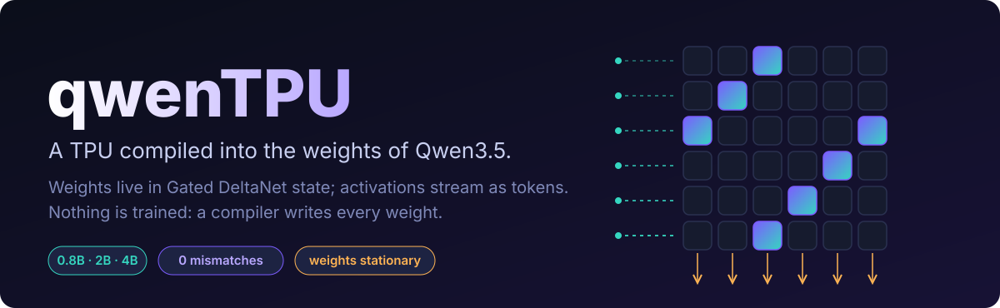

<p align="center"></p>

<p align="center">
<b>A weight-stationary TPU, compiled into the weights of Qwen3.5. No training. No external runtime.</b><br>
<sub>0.8B · 2B · 4B &nbsp;|&nbsp; up to 32×32 (1,024 MACs per matvec) &nbsp;|&nbsp; 5-bit operands &nbsp;|&nbsp; 393,984 replayed outputs, 0 mismatches &nbsp;|&nbsp; text KL ≤ 0.005 after a chip run &nbsp;|&nbsp; MIT</sub>
</p>

<p align="center">
<a href="docs/site/index.html"><b>Interactive walkthrough</b></a> &nbsp;·&nbsp;
<a href="WRITEUP.md"><b>Write-up</b></a> &nbsp;·&nbsp;
<a href="#results"><b>Results</b></a> &nbsp;·&nbsp;
<a href="#quickstart"><b>Quickstart</b></a>
</p>

---

## The idea in one paragraph

A TPU is a dataflow machine: **weights stay put, activations flow past them, partial sums accumulate in place.**
A Gated DeltaNet head already is one. Its state is a matrix `S`, a one-hot write replaces a row exactly, and a
**multi-hot read returns the exact sum of the chosen rows**. So a matrix multiply becomes: weights live in state,
activations arrive as tokens, products are bit-ANDs in SwiGLU layers, the reduction is *one head read*, and the
result is sampled as the next token, which is the next layer's input.
A compiler writes every new weight. Qwen's own weights are untouched.

<p align="center"></p>

```text
CELL(r,c,w)  x KR*NC   load the weights once          one token writes one weight into DeltaNet state
ACT(i,v)     x KR      stream the input vector        row i of the accumulators <- AND-products
READ(c)      x NC      read a column                  multi-hot sum of rows -> adder tree -> OUT(v)
                                                      OUT(v) is the model's own next token = the next layer's input
```

Nothing is a plug-in or a tool call. Every step is a forward pass of the stock Qwen3.5 architecture.

## What is special

| | |
|---|---|
| **A TPU, not another CPU** | No program counter, no fetch, no decode, no instruction stream. The layer stack *is* the datapath. |
| **The DeltaNet read is the adder tree** | One multi-hot query sums KR rows exactly. The contraction over the inner dimension is a single head read. |
| **Weights *and* partial sums live in state** | Stationary-weight heads feed per-input accumulator heads. Every vector rewrites all KR rows, so nothing is ever flushed. |
| **Exact integer matmul under bf16** | Products are bit-ANDs and accumulators hold *counts*, so everything stored or read is a small integer bf16 represents exactly. |
| **A carry-save adder tree built from SwiGLU** | Bit-plane counts fold into the requantised output with saturating Horner steps, 2 units per step (below). This is what lets operands go from 3 to 5 bits. |
| **Layers chain through the model's own tokens** | ReLU and requantisation happen inside the model. The host relabels a token and does no arithmetic. |
| **Scales like a TPU** | `KR + NC` tokens for `KR × NC` MACs once weights are resident: O(N) tokens for O(N²) MACs. Measured: 4 → 8 → 16 MACs/token at 8×8 → 16×16 → 32×32. |

### What is *not* new

Putting a machine into Qwen3.5's weights, and running a neural network on it, is not new.
[Qwenputer](https://github.com/divagr18/qwenputer) put a RISC-V CPU there and ran stories260K on an in-weights NPU;
[QwenPU](https://github.com/divagr18/QwenPU) added a 64-lane int8×int4 vector unit; qwenGPU did a SIMT GPU.
The design vocabulary (ballast-normalised RMSNorm, DeltaNet rows as RAM, tokens as the trace) is theirs.
What I believe is new (one search, not exhaustive) is the **architecture**: a weight-stationary dataflow array instead of a processor.
It is **not faster than QwenPU at the op level**: its matvec streams 64 lanes per token, mine does 4 to 16 MACs per token.

| | machine | control | state holds | a token is |
|---|---|---|---|---|
| Qwenputer | RV32IM CPU | PC, fetch, decode | registers, code, data | an instruction |
| QwenPU | CPU + vector unit | the CPU's program | vector regs, weight rows, KV | a vector-op step |
| qwenGPU | SIMT GPU | host-compiled kernel | registers, global memory | a warp-launch record |
| **qwenTPU** | **weight-stationary array** | **none** | **weights and partial sums** | **a dataflow step** |

### Do we need TinyTPU?

No. [TinyTPU](https://github.com/tiny-tpu-v2/tiny-tpu) is real RTL, and this repo shares **no code, no netlist, no tests** with it.
It is the *reference for the architecture*: weights held in the PEs, activations streamed, integer accumulate, a post-processing unit for bias and ReLU.
I keep it as credit and as a vocabulary anchor, and I don't lean on it for anything else. Two honest differences:
this array is not *systolic in space* (no PE-to-PE forwarding: every column sees the same `ACT` token and rows are serial in token time),
and it is inference-only (TinyTPU also trains). If the word "TPU" ever claims more than "weight-stationary dataflow matrix unit with a requantising output stage", that is the overreach to avoid.

## How the adder tree works

<p align="center"></p>

Per column, the accumulator head returns counts `cnt[j][b]` = how many rows have activation bit *j* and weight bit *b* both set.
With `s_j = Σ_b wt_b · cnt[j][b]` (top weight bit negative), the exact result is `y = Σ_j 2^j s_j`, but `y` is far too wide for a bf16-exact comparator.
So it is folded **top-down**: `u ← clamp(2^q · u + ⟨q more digits⟩)`. The clamp bounds are exactly the values beyond which the
lower digits can no longer change `relu + clamp(y)`, so saturating early is *lossless*; it costs two SwiGLU units (`Z + relu(lo−Z) − relu(Z−hi)`),
and the last step is merged straight into the output-code FFN. A static planner (`circuit.horner_plan`) picks how many digits to absorb per step
and refuses configurations whose windows exceed bf16's exact range (256).

**A bug worth knowing about.** Qwen l2-normalises the query and scales it by `1/√128`. For a multi-hot query of `n` rows
that factor is exact only if `n·128` is a power of 4. At KR=16 it is not, bf16 rounds `count × scale` differently for each count,
and a count of 7 came back as 6.96875 (3 of 6,144 outputs wrong on an A100, none in the float64 sim). The fix pads the query with unused,
all-zero state rows, and the exactness evaluator now rejects any multi-hot query whose size breaks the rule.

## Results

Stock `Qwen3_5ForCausalLM`, bf16, real checkpoints, A100. Every predicted token is compared with NumPy. **393,984 outputs, 0 mismatches.**

**Arrays** (`QWENTPU_CFG=rows,cols,abits,wbits`; weights two's complement, activations unsigned, output requantised to `abits`).
All six were replayed on 0.8B, 2B and 4B; the 7-test model suite passes on 0.8B for all six and on 2B and 4B for 8×8, 16×16 u4s4 and 32×32.

| array | MACs / matvec | tokens / matvec | MACs / token | chip layers |
|---|---|---|---|---|
| 8×8, u3 × s3 | 64 | 16 | 4.0 | **2** |
| 8×8, u4 × s4 | 64 | 16 | 4.0 | 4 |
| 8×8, **u5 × s5** | 64 | 16 | 4.0 | 7 |
| 16×16, u3 × s2 | 256 | 32 | 8.0 | 2 |
| 16×16, u4 × s4 | 256 | 32 | 8.0 | 5 |
| **32×32, u3 × s3** | **1,024** | 64 | **16.0** | 6 |

**Per model** (8×8 u3s3 shown).

| | 0.8B | 2B | 4B |
|---|---|---|---|
| layers (Qwen + TPU) | 24 + 2 | 24 + 2 | 32 + 2 |
| hidden (base → merged) | 1024 → 1280 | 2048 → 2304 | 2560 → 2816 |
| value / key heads | 16 / 16 | 16 / 16 | **32 / 16** |
| pure-text KL vs base | 4.6e-4 – 6.9e-4 | 2.5e-4 – 6.0e-4 | 3.1e-4 – 5.4e-4 |
| chip logit at text positions | ≈ −2.6e6 – −2.8e6 | ≈ −1.1e6 | ≈ −5.6e5 – −6.1e5 |

**Speed** (tokens/s, `bench.py`, teacher-forced: a matvec's inputs are known up front, so it runs as one prefill; only the hop between layers waits for the model's own token).
The A100 is shared, so expect ±20%.

| | batch 1 | batch 16 |
|---|---|---|
| 0.8B · 8×8 / 16×16 u4s4 / 32×32 | 2.0k / 5.6k / 15.5k | 33.1k / 36.4k / **36.5k** |
| 2B · 8×8 / 16×16 u4s4 / 32×32 | 2.1k / 5.4k / 16.8k | 28.4k / 26.1k / 25.3k |
| 4B · 8×8 / 16×16 u4s4 / 32×32 | 1.5k / 4.3k / 10.5k | 13.8k / 12.7k / 12.4k |

Bigger arrays are free at the token level: the 32×32 array does 16× the MACs of 8×8 at roughly the same tokens/s, so MACs/s scales with array size.

### What changed from the first version

| | v1 | now |
|---|---|---|
| chip layers, 8×8 | 4 | **2** (the output code is one FFN; comparator and decode levels are gone) |
| weight load | 2 tokens per cell | **1** (`CELL(r,c,w)`) |
| tokens per matvec | `KR + NC + 1` | `KR + NC` (no flush: every vector rewrites all rows) |
| operand width | u3 × s3, or u3 × s2 at 16×16 | up to **u5 × s5** (adder tree) |
| largest array | 16×16 | **32×32** (heads spill across layers) |
| residual dims for 32 rows × 32 cols | would need one dim per cell | `row ∧ col` formed free by conv+silu: ~800 dims total |
| latent numerics bug at KR=16 | present | found and fixed (above) |

### Invisible to the text path

Chip tokens are **muted** inside Qwen's own layers (GDN `a=b=z=−1024`, attention output gate, an anti-sink key), and `tau` keeps them from ever being sampled in prose.
`HybridSession` goes one step further: it snapshots Qwen's cache around a chip run and restores it, so a TPU computation leaves no trace in Qwen's context.

| text after a TPU run vs no run at all | first token | worst token |
|---|---|---|
| muting only (0.8B / 2B / 4B) | KL 1.31 / 1.19 / 1.14 | 4B: 0.61 |
| muting + `HybridSession` restore, 0.8B | **0.0020** | 0.0031 |
| muting + `HybridSession` restore, 2B | 0.0008 | 0.0017 |
| muting + `HybridSession` restore, 4B | 0.0014 | 0.0047 |

Also checked: the IR under a bf16 exactness evaluator, the circuit alone in a stock HF model (bf16 and fp32), TPU exact after text is already in Qwen's state,
a mutation test (zero the TPU layers and the answers break), and XOR plus random 2-layer MLPs end to end through the real model with a cache.

## Quickstart

```bash
pip install -e ".[dev]"
python demo.py                                         # float64 sim of the datapath, no model needed
python -m pytest -q tests/test_qwentpu.py tests/test_circuit_ir.py tests/test_circuit_hf.py

hf download Qwen/Qwen3.5-0.8B --local-dir q08          # or 2B / 4B
QWEN_DIR=q08 python -m pytest -q tests/test_merged.py -s
QWENTPU_CFG=32,32,3,3 QWEN_DIR=q08 python bench.py 60 --device cuda --batch 16
python -m qwentpu.merge q08 out/qwen35-0.8b-tpu        # write the checkpoint
```

```python
from qwentpu.merge import build_merged, instantiate
from qwentpu.driver import HybridSession

tc, sd, v0, lay, g = build_merged("q08"); model = instantiate(tc, sd)
s = HybridSession(model, v0)
s.text(tokenizer("What is 2+2?").input_ids)            # ordinary Qwen text
with s.chip():                                         # the TPU runs inside the same model, invisibly
    s.load_weights(W)                                  # KR*NC tokens, once
    y = s.matvec(x)                                    # AMAX-bounded activations in, out
```

## Repo map

| path | what |
|---|---|
| `qwentpu/circuit.py` | the TPU, written in the IR: weight/accumulator heads, AND products, adder-tree planner |
| `qwentpu/compiler/` | **own compiler**: IR, bf16 exactness evaluator, weight emitter, integer gadgets |
| `qwentpu/merge.py`, `mute.py` | widen Qwen, append the TPU layers, `tau`, muting |
| `qwentpu/driver.py` | cached token driver, `HybridSession` |
| `bench.py` | mass replay against NumPy (`--device cuda --batch N`) |
| `qwentpu/gdn.py`, `model.py`, `tpu.py` | the float64 reference sim of the same datapath |
| `docs/site/` | interactive walkthrough; `docs/tools/gen_svgs.py` regenerates the diagrams |
| [`WRITEUP.md`](WRITEUP.md) | how it works in full, and how it relates to qwenGPU / qwenCPU / TinyTPU |

## Limits, honestly

* **The window.** Every comparator input must stay within bf16's exact range (256). That caps `KR · 2^(WB−1)` at roughly 128 per step:
  16×16 u5s5 and 32×32 u4s4 are rejected by the planner. Going further needs a second adder-tree level (digit-wise requantisation); it is not built.
* **Throughput is teacher-forced prefill.** There is no fused custom executor (Qwenputer has one), so a free-running single stream is not faster than the batch-1 column.
  HF + flash-linear-attention in bf16, on a shared A100.
* **CPU speed is not reported** for this version: the 4B CPU run is ~13 tok/s with PyTorch fallbacks, and I did not re-run the full CPU matrix.
* Text-only checkpoints. Inference only (no backprop, unlike TinyTPU).
* The restore trick is a host-side cache operation, not a weight-level fix. Without it, the first ~3 text tokens after a run are perturbed by Qwen's conv window.
* Merged checkpoints are built on the fly (`qwentpu.merge`); none are uploaded.

## Credits

Design vocabulary: **Qwenputer** (Divyansh Agrawal), with which this repo shares no code. Architecture reference: **TinyTPU** (Surya Sure et al.), likewise no code. Base models: **Qwen3.5**. MIT licensed.
